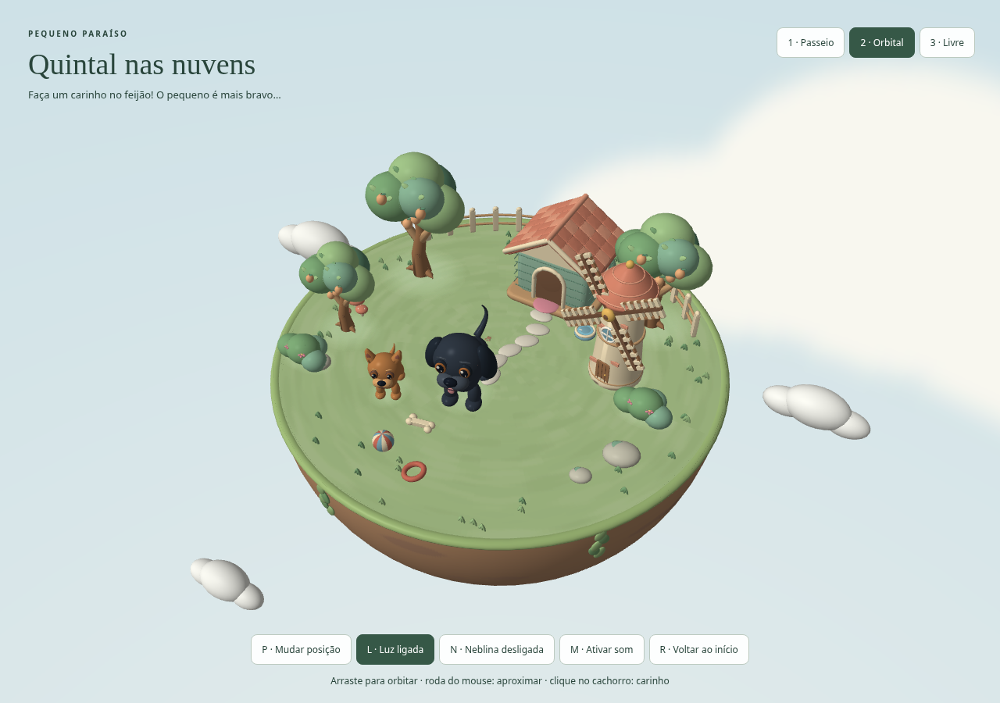
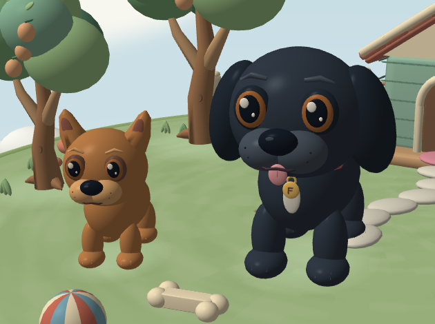

# tp2-cg

## A Cena

Um paraíso para o Feijão e Pingo: uma pequena ilha com árvores, arbustos, pedras,
casinha, moinho e dois caẽzinhos, Feijão e Pingo (nossos cachorrinhos na vida real). 
Clique no Feijão para fazer carinho. O Pingo rosna e assusta o Feijão quando recebe um clique. 
Explore as três câmeras. Implementado com JavaScript, WebGL 2 e TWGL.

### Controles

| Controle | Ação |
| --- | --- |
| `1` | Passeio automático a 45° olhando o centro |
| `2` + arrastar | Câmera orbital com alvo no centro |
| Roda do mouse | Aproximar/afastar nas câmeras 1 e 2 |
| `3` + `WASD` | Câmera livre |
| Arrastar na câmera 3 | Mudar a direção do olhar |
| `Q` / `E` | Descer / subir na câmera livre |
| `P` | Alternar juntos as três posições e orientações dos dois cachorros |
| Clique no Feijão (maior) | Carinho, coração e pequeno salto |
| Clique no Pingo | Rosnado e emoji raivoso, Feijão se assusta, recua e mostra emoji susto |
| `L` | Ligar/desligar iluminação |
| `N` | Ligar/desligar neblina |
| `M` | Ligar/desligar música, pássaros, vento, carinho e rosnado |
| `R` | Recuperar a câmera inicial |

O áudio começa apenas após ativação pelo usuário. 

## Criador(es)

- Fernanda Moreira Thomaz Contato: [e-mail: fermtthomaz@gmail.com]
- Mariana Matias do Nascimento Contato: [e-mail: mmatias0310@gmail.com]

## Media kit

Cena com os cachorros e o diorama completo.

## Opcionais

1. **Modelos tridimensionais** — carregador OBJ em `js/obj.js`. Os cães, árvores,
   arbustos, pedras, casinha, moinho e detalhes do jardim são importados dos
   arquivos `*-cartoon.obj` em `assets/modelos/`.
2. **Skybox, skyphere ou skydome** — skysphere texturizada que acompanha a posição
   da câmera, mantendo a orientação do horizonte.
3. **Interação** — clique no Feijão gera coração, salto e som; clique no Pingo
   gera rosnado, emoji de irritação e susto no Feijão. Sons respeitam a opção de
   áudio; objetos à frente bloqueiam a seleção.
4. **Câmera de navegação livre** — tecla `3`, deslocamento WASD e orientação por
   arrasto do mouse; Q/E controlam a altura.
5. **Neblina** — mistura com a cor ambiente conforme a distância; tecla `N`.
6. **Música, efeitos sonoros e/ou som ambiente** — melodia instrumental com
   pássaros e vento suave em loop e efeito
   de carinho e uma gravação real de rosnado. Tecla `M` e botão para ativar/silenciar.

## Creditos

- Modelos tridimensionais: IA 